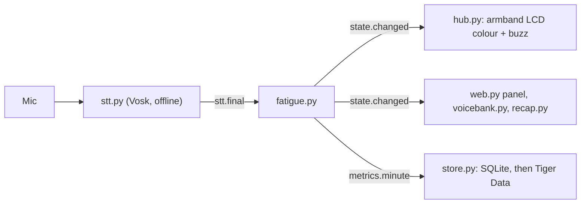

# fatigue.py: speech fatigue score

**Made with:** Claude (Anthropic)\
**Runs on:** the laptop, inside `app.py` · **Needs:** Python standard library only
(`tzdata` on Windows; `pronouncing` is optional)

`fatigue.py` listens to Alex's speech and, once per minute of talking, compares his speed and clarity
with his own baseline. The result is a fatigue score from 0 to 1 and a state, **fresh**, **tiring** or
**recap_ready**, which the armband, the control panel, the voice bank and the recap react to.



## How it decides

1. **Listen.** `stt.py` publishes every phrase Vosk recognises (`stt.final`), with each word's start
   and end time and its confidence. Vosk runs offline on the laptop.
2. **Count minutes from his first word.** Words are grouped into 60-second windows that start at his
   first word, not at the clock minute. A window with fewer than 15 words is skipped: he isn't talking.
3. **Measure each minute.**
   - `wpm`: words per minute of speech (words divided by the total length of his phrases).
   - `mean_conf`: the average Vosk word confidence, used as the clarity signal.
   - Logged but not scored: `pause_ratio` and `ms_per_syll`.
4. **Calibrate on his first minute of talking.** That minute becomes his baseline (`wpm` and `conf`).
   It needs at least 30 s of speech: a mic check or a few words don't count, and calibration starts
   again at his next phrase. The baseline lives in memory only, so every start of `app.py`, and
   **Reset session** on the control panel, calibrates again.
5. **Score every minute after that.**

   ```text
   speed_drop   = max(0, 1 - wpm / baseline_wpm)
   clarity_drop = max(0, (baseline_conf - conf) / baseline_conf)
   raw          = 0.5 * min(1, speed_drop / 0.28) + 0.5 * min(1, clarity_drop / 0.07)
   fatigue      = SMOOTH_PREV * previous + (1 - SMOOTH_PREV) * raw
   ```

   A 28 % drop in speed, or a 7 % drop in clarity, fills its half of the score.
6. **Turn the score into a state.**

   | Score       | State         | Armband                               |
   |-------------|---------------|---------------------------------------|
   | below 0.35  | `fresh`       | green                                 |
   | 0.35 – 0.70 | `tiring`      | amber, with a 150 ms buzz when it starts |
   | 0.70 and up | `recap_ready` | purple                                |

   The state changes only after `STATE_AGREE_MINUTES` minutes in a row agree. Going up it moves one
   step per minute, so amber (and the buzz) always comes before purple. Going down it moves to the
   higher of those minutes' states.
7. **The time of day is not used.** There is no afternoon rule, no reset at midnight and no baseline
   reused from an earlier run.

### Passage mode (optional)

If `config.PASSAGE_TEXT` is set, clarity becomes word accuracy against that passage instead of Vosk
confidence. Each minute's words are aligned to the best-matching stretch of the passage with an
edit-distance alignment (`align_segment`, the LCS family with a cost for skipped words). Use it only
while someone reads that passage. In this repo `PASSAGE_TEXT = None`, so the app runs in **class** mode.

## Events (bus.py)

| Direction | Topic            | Payload |
|-----------|------------------|---------|
| in        | `stt.final`      | `{text, words: [{word, start, end, conf}], t0, t1}` |
| in        | `debug.fatigue`  | `{level}` from the panel's Fresh / Tiring / Recap ready buttons (demo mode): the level becomes the score |
| in        | `debug.reset`    | Reset session (demo mode): score 0, `fresh`, calibrate again |
| out       | `metrics.minute` | `{ts, wpm, mean_conf, pause_ratio, n_words, fatigue, state, mode, accuracy, ms_per_syll, day_part, baseline_wpm, baseline_conf}`, one per minute of talking |
| out       | `state.changed`  | `{state}`: `fresh`, `tiring` or `recap_ready` |

`store.py` saves every `metrics.minute` (SQLite on the laptop, then Tiger Data), and the control panel
shows it as "X wpm (baseline Y)". `day_part` (am/pm) is only a label for the database.

## Settings

All optional; `fatigue.py` reads them from `config.py` when they are there.

| Setting                               | Default in `fatigue.py` | `config.py` in this repo |
|---------------------------------------|-------------------------|--------------------------|
| `FATIGUE_CALIBRATION_MINUTES`         | 1                       | not set                  |
| `STATE_AGREE_MINUTES`                 | 2                       | 1 (demo value)           |
| `FATIGUE_SMOOTH_PREV`                 | 0.6                     | 0.4 (demo value)         |
| `MIN_WORDS_PER_MINUTE`                | 15                      | not set                  |
| `WPM_FULL_DROP` / `CLARITY_FULL_DROP` | 0.28 / 0.07             | not set                  |
| `TIRING_AT` / `RECAP_AT`              | 0.35 / 0.70             | not set                  |
| `FATIGUE_MODE` / `PASSAGE_TEXT`       | `class` / `None`        | `PASSAGE_TEXT = None`    |
| `FINALS_LOG`                          | `None`                  | `None`                   |

`BASELINE_MINUTES`, `BASELINE_FILE` and `LATE_RECAP_TIME` in `config.py` are not used by `fatigue.py`.
(`fatigue_simple.py`, the fallback that `app.py` loads only if `fatigue.py` fails to import, still
uses `BASELINE_MINUTES`.)

For a real school day: `FATIGUE_CALIBRATION_MINUTES = 5`, `STATE_AGREE_MINUTES = 2`,
`FATIGUE_SMOOTH_PREV = 0.6`.

## Run

- **In the app:** `python app.py` calls `fatigue.start()`. With this repo's `config.py` the console shows

  ```text
  [fatigue] class mode: calibrates on his first 1 min of talking, then one score per minute; state changes after 1 min, smoothing 0.4; time of day not used
  ```

  and, after his first minute, `[fatigue] calibrated on his first minute of talking: ... wpm, conf ...`.
  If you see `[app] fatigue.py could not load`, the app is running the fallback instead.
- **Demo tip:** it calibrates on the first voice it hears, so press **Reset session** right before he
  starts talking.
- **Replay real Vosk output:** set `FINALS_LOG = "finals.jsonl"` in `config.py`, run the app, then
  `python fatigue.py --replay finals.jsonl`.

## Validation status: not validated yet

This is a hackathon prototype, not a medical device, and it still needs proper validation before
anyone relies on it. So far it has only been tested with live speech, talking normally and then
talking slowly. It has not been validated on VOC-ALS or on any other dataset.

Still to do:

- **Test it with people with ALS**, over full school days, not just short demos.
- **Compare the score with clinical measures of speech**, for example intelligibility ratings or the
  ALSFRS-R speech item.
- **Set the thresholds from that data.** Today the 0.28 and 0.07 come from the case's numbers
  (165 → 118 wpm; 98 % → 91 % intelligibility), and the 0.35 and 0.70 cut-offs were not set from data
  either.
- **Test it in real classrooms**, with noise, different mic positions and different accents.

## Known limitations

- **Clarity is measured indirectly.** It is Vosk's word confidence, which noise, the mic and accent
  also lower.
- **One minute of calibration is enough for a demo, but noisy.** For real use, see the school-day
  settings above.
- **It calibrates on whoever speaks first.** Press Reset session before he starts.
