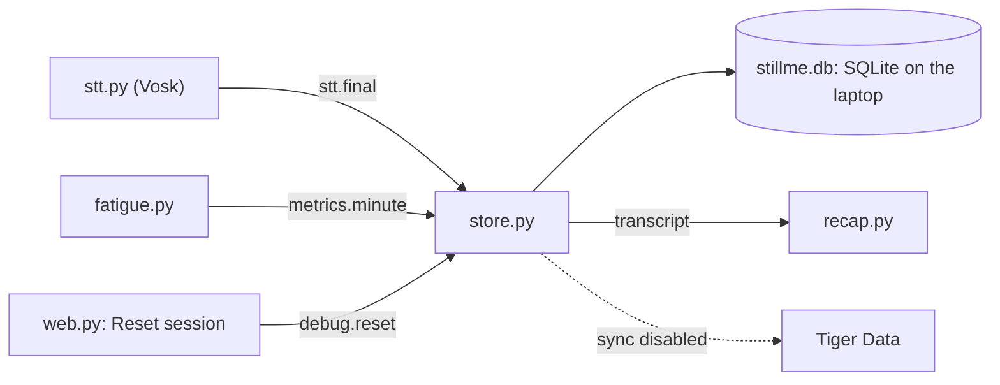

# store.py: local storage

**Made with:** Claude (Anthropic)\
**Runs on:** the laptop, inside `app.py` · **Needs:** Python standard library only
(`psycopg` only for the Tiger Data sync, which is disabled)

`store.py` keeps the class on the laptop. Every phrase Vosk transcribes and every minute that
`fatigue.py` scores are saved in a local SQLite file, `stillme.db` [1]. The recap reads the transcript
back from here.

> **Tiger Data sync: disabled.** The project was never connected to a Tiger Data service, so
> `TIGER_DSN` is empty and every minute stays only in `stillme.db`. The sync code is still in
> `store.py`, but it does nothing while `TIGER_DSN` is empty. At start-up the console says
> `store.py: no TIGER_DSN in config, metrics stay local only`.



## What it saves

| Table     | One row per                               | Columns |
|-----------|-------------------------------------------|---------|
| `finals`  | phrase Vosk recognises                    | `t0`, `t1` (start and end, Unix time), `text`, `mean_conf` (average word confidence) |
| `metrics` | minute of talking scored by `fatigue.py`  | `ts`, `wpm`, `mean_conf`, `pause_ratio`, `n_words`, `fatigue`, `state`, `mode`, `accuracy`, `ms_per_syll`, `day_part`, `synced` |

- The file is `stillme.db`, in the folder you start `app.py` from. `.gitignore` keeps it out of git.
- It uses SQLite's write-ahead log (WAL) mode, so another program can read the file while the app
  writes to it [2].
- `synced` stays 0 while the Tiger Data sync is disabled.
- `fatigue.py` also sends `baseline_wpm` and `baseline_conf` for the control panel; they are not saved.

## Events (bus.py)

| Direction | Topic            | What `store.py` does |
|-----------|------------------|----------------------|
| in        | `stt.final`      | saves the phrase in `finals` |
| in        | `metrics.minute` | saves the minute in `metrics` |
| in        | `debug.reset`    | Reset session (demo mode): deletes today's phrases from `finals`; `metrics` is kept |

`store.py` publishes nothing.

## Functions other modules can call

| Function                    | Returns | Used by |
|-----------------------------|---------|---------|
| `store.transcript_since(ts)` | the text of every phrase that ended at or after `ts`, in order | `recap.py` |
| `store.metrics_today()`      | today's minutes, as a list of dicts | nothing yet |

`app.py` starts it with `store.start()`. If `store.py` fails to import, the app runs without it and
the recap uses its own in-memory transcript instead. The tables and these functions follow the team's
project plan [3].

## Settings

All optional; `store.py` reads them from `config.py` when they are there. In this repo `config.py`
only has `TIGER_DSN` (read from `.env`, and empty).

| Setting           | Default            | What it does |
|-------------------|--------------------|--------------|
| `DB_PATH`         | `stillme.db`       | the SQLite file, relative to the folder you start the app from |
| `TZ_NAME`         | `America/Toronto`  | sets what "today" means for Reset session and `metrics_today()` |
| `TIGER_DSN`       | empty              | the Tiger Data connection string; empty means the sync is off |
| `PATIENT_ID`      | `alex`             | sync only |
| `SESSION_ID`      | start date and time + 4 random characters | sync only |
| `SYNC_INTERVAL_S` | 60                 | sync only |

## Tiger Data sync (disabled)

What the code does if `TIGER_DSN` is set:

- Every 60 s a background thread sends the minutes with `synced = 0` to the `speech_metrics` table in
  Tiger Data, a managed PostgreSQL with TimescaleDB [4], using psycopg [5]. Then it marks them
  `synced = 1`.
- It sends only `metrics` rows (the numbers, the state, the mode, am/pm, and the patient and session
  ids), never the transcript or audio.
- If the connection fails, the minutes wait on the laptop and are sent on the next try.
  `INSERT … ON CONFLICT DO NOTHING` on (`patient_id`, `time`) means a retry never stores a minute
  twice [6].

It has never run against Tiger Data; it was only tried against a local PostgreSQL 16 with
TimescaleDB 2.31.

To turn it on later:

1. Put the Tiger Data connection string in `.env` as `TIGER_DSN`.
2. Run `pip install "psycopg[binary]"` (it is not in `requirements.txt`).
3. Create the table in Tiger Data:

   ```sql
   CREATE TABLE speech_metrics (
     time timestamptz NOT NULL, patient_id text NOT NULL, session_id text,
     wpm real, mean_conf real, pause_ratio real, n_words int, fatigue real,
     state text, mode text, accuracy real, ms_per_syll real, day_part text);
   SELECT create_hypertable('speech_metrics', 'time');   -- optional, TimescaleDB
   CREATE UNIQUE INDEX ON speech_metrics (patient_id, time);
   ```

4. `python store.py --check` shows the local counts and tries one sync. It prints `error: none` even
   when psycopg is missing, so also check that app.py doesn't print `psycopg missing` at start-up.

## Known limitations

- **The transcript is plain text.** It is stored unencrypted in `stillme.db`, so anyone with access to
  the laptop can read it.
- **Nothing is deleted automatically.** Reset session deletes only today's phrases; the minutes in
  `metrics` stay until someone deletes the file.
- **The demo buttons write a fake minute.** The Fresh / Tiring / Recap ready buttons in `web.py` also
  save a minute with 0 words and no wpm, so filter `n_words > 0` when you chart the data.
- **The file goes where you start the app.** `DB_PATH` is relative, so starting `app.py` from another
  folder creates another `stillme.db`.
- **What leaves the laptop.** With the sync disabled, `store.py` sends nothing. The recap does: it reads
  the transcript from here and sends it to Gemini for the summary.

## Sources

1. Python documentation. *sqlite3: DB-API 2.0 interface for SQLite databases*.
   https://docs.python.org/3/library/sqlite3.html
2. SQLite. *Write-Ahead Logging*. https://www.sqlite.org/wal.html
3. BioHacks 2026, Wearables track: the team's project plan. Source of the two tables, of
   `transcript_since` and `metrics_today`, and of Reset session clearing today's transcript.
4. Tiger Data. *Tiger Cloud* documentation. https://www.tigerdata.com/docs/learn/tiger-cloud
5. *Psycopg 3* documentation. https://psycopg.org/psycopg3/docs/
6. PostgreSQL documentation. *INSERT* (ON CONFLICT clause). https://postgresql.org/docs/18/sql-insert.html
